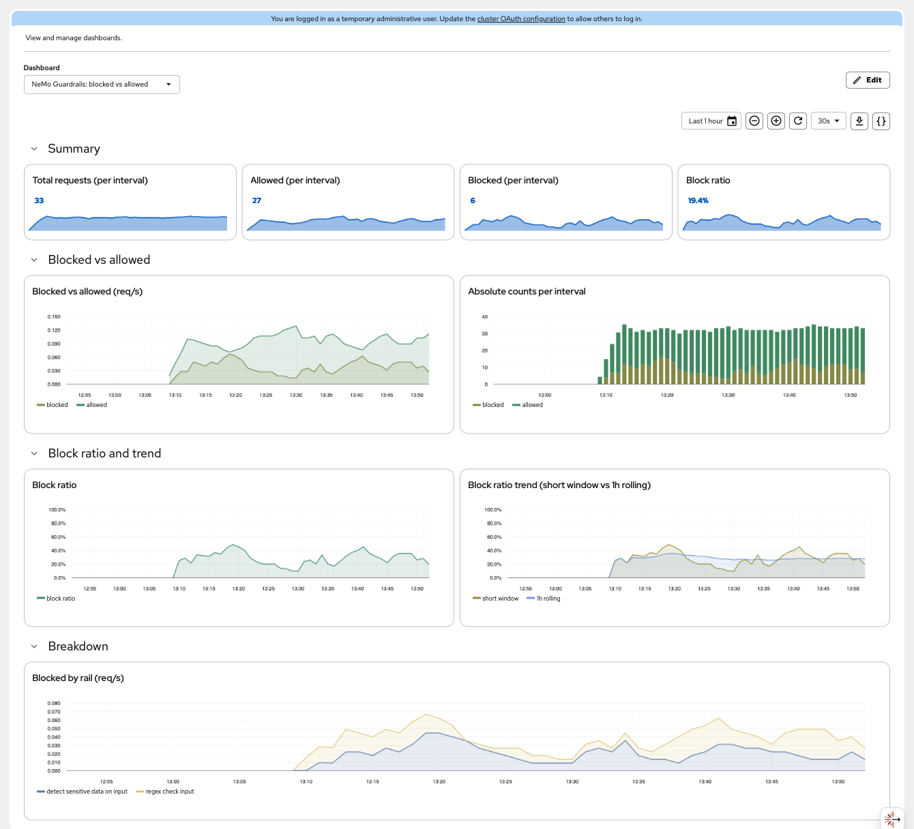
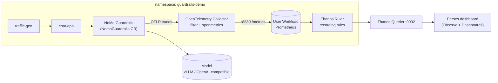

# demo-guardrails

Blocked-vs-allowed observability for **NeMo Guardrails on Red Hat OpenShift AI**.

This demo deploys a guardrails configuration in front of a model, runs a small AI app and a traffic
generator against it, turns NeMo's OpenTelemetry traces into Prometheus metrics, and shows them on a
**Perses** dashboard in the OpenShift console:

- blocked vs allowed request rate
- block ratio
- absolute counts per interval
- block-ratio trend (short window against a 1h rolling baseline)
- blocked requests by rail

Everything is reproducible with three environment variables and one script.



*The dashboard in the OpenShift console (Observe, Dashboards (Perses)) over a full hour of synthetic
traffic whose block rate swings between roughly 0% and 50%. Top to bottom: summary stats for the latest
interval, blocked vs allowed rate and absolute counts per interval, block ratio and its trend against a 1h
rolling baseline, and blocked requests by rail (Presidio on input, the regex rail, and a few Presidio
blocks on output at the right edge).*

## Why this exists

With the rails used here (Presidio and regex), NeMo Guardrails on RHOAI exports **traces only**
(`OTEL_METRICS_EXPORTER=none`). NeMo's native request counters are emitted only by its newer IORails engine,
which does not support these rails, so there is no ready-made `guardrails_requests_blocked_total` to chart.
This repo shows how to derive it from the
spans NeMo already emits, with nothing but supported Red Hat components (OpenTelemetry Collector,
User Workload Monitoring, Cluster Observability Operator). It also records what behaves differently
from the documentation. See [docs/how-it-works.md](docs/how-it-works.md).

## Architecture



## Prerequisites

| Need | Notes |
|---|---|
| OpenShift | Tested on 4.21 only; older releases were not tested |
| Red Hat OpenShift AI 3.5+ | TrustyAI component set to `Managed` (provides the `NemoGuardrails` CRD) |
| `cluster-admin` | Installs operators and enables a console plugin |
| User workload monitoring | `enableUserWorkload: true` in `cluster-monitoring-config` (see below) |
| `redhat-operators` catalog | Must offer `opentelemetry-product` and `cluster-observability-operator` (tested with COO 1.5.3; the dashboard CRs use `perses.dev/v1alpha2`) |
| An OpenAI-compatible model | Endpoint ending in `/v1` plus an API key (a KServe vLLM service works) |
| Local tools | `oc`, `bash`, `python3` (only for `verify.sh`) |

Enable user workload monitoring if it is not already on (merge into the existing ConfigMap if you have
one; applying this blindly overwrites it):

```yaml
apiVersion: v1
kind: ConfigMap
metadata:
  name: cluster-monitoring-config
  namespace: openshift-monitoring
data:
  config.yaml: |
    enableUserWorkload: true
```

If your model endpoint uses a certificate that is not signed by the OpenShift service CA or the
cluster trust bundle, add `spec.caBundleConfig.configMapName` to the `NemoGuardrails` CR in
`manifests/03-nemo-guardrails.yaml`.

## Quick start

```bash
oc login https://api.<your-cluster>:6443

export MODEL_NAME=<served model id>                       # optional: what /v1/models reports
export MODEL_BASE_URL=https://<model-svc>.<ns>.svc.cluster.local:8000/v1
export MODEL_API_KEY=<token for the model endpoint>

./scripts/deploy.sh        # operators, collector, guardrails, app, dashboard
./scripts/verify.sh        # every stage green and current numbers
./scripts/probe.sh         # four sample prompts: chat completions, then /v1/checks
```

Then open the OpenShift console: **Observe, Dashboards (Perses)**, project `guardrails-demo`,
dashboard **NeMo Guardrails: blocked vs allowed**. Data appears one to two minutes after the first
traffic. A first run that also installs the two operators takes several minutes longer.

Optional environment variables for `deploy.sh`:

| Variable | Default | Purpose |
|---|---|---|
| `MODEL_NAME` | model of an existing deployment, else the lab default `qwen3-27b-nvfp4` | Model id your endpoint serves (what `/v1/models` reports). Set it for any other environment |
| `NAMESPACE` | `guardrails-demo` | Target namespace (every manifest is templated) |
| `OC_CONTEXT` | current context | Use a specific kubeconfig context |
| `SKIP_OPERATORS` | `0` | Set to `1` if the operators are already installed |
| `SKIP_TRAFFIC` | `0` | Set to `1` to deploy with the traffic generator at 0 replicas |

## What the script does

You can apply the manifests by hand; `scripts/_common.sh` renders three placeholders
(`${NAMESPACE}`, `${MODEL_NAME}`, `${MODEL_BASE_URL}`) with `sed`.

| Step | File | Scope | What |
|---|---|---|---|
| 0 | `manifests/00-operators.yaml` | cluster | OpenTelemetry and Cluster Observability operators, **each in its own namespace and OperatorGroup** |
| 1 | `manifests/01-namespace.yaml` | cluster | Demo namespace |
| - | (created by `deploy.sh`) | ns | `model-api-key` Secret from `MODEL_API_KEY` (never written to a file) |
| 2 | `manifests/02-otel-collector.yaml` | ns | Collector: OTLP in, filter, `spanmetrics`, Prometheus exporter |
| 3 | `manifests/03-nemo-guardrails.yaml` | ns | Rails ConfigMap and the `NemoGuardrails` CR with tracing and OTEL env |
| 4 | `manifests/04-app-rbac.yaml` | ns | ServiceAccount the app uses to authenticate to NeMo |
| 5 | `manifests/05-monitoring.yaml` | ns | ServiceMonitor and recording rules (`guardrails_requests_*`) |
| 6 | `manifests/06-chat-app.yaml` | ns | Chat app and traffic generator |
| 7 | `manifests/07-perses-uiplugin.yaml` | cluster | Enables Perses in the console |
| 8 | `manifests/08-perses-datasource.yaml` | ns | Perses datasource to the Thanos Querier |
| 9 | `manifests/09-perses-dashboard.yaml` | ns | The dashboard |

Why separate namespaces for the operators: see
[docs/troubleshooting.md](docs/troubleshooting.md#operator-install-plan-is-manual-and-bundles-another-upgrade).

## The guardrails configuration

`manifests/03-nemo-guardrails.yaml` ships a deliberately small policy:

| Stage | Rail | Catches |
|---|---|---|
| input | `detect sensitive data on input` (Presidio) | email, phone (international format), credit card, and some SSNs (it missed `123-45-6789` at the 0.5 threshold; the regex rail below covers the pattern) |
| input | `regex check input` | words like `password`/`api_key`/`token`, and `NNN-NN-NNNN` |
| output | `detect sensitive data on output` (Presidio) | same entities in model responses |
| output | `regex check output` | the same keyword pattern in model responses. It scans the whole response, including a reasoning model's thinking text |

Tracing is on with `enable_content_capture: false`, so prompts and responses are never put in spans.
To change the policy, edit the ConfigMap. In testing on RHOAI 3.5.1 the operator replaced the NeMo pod
within about 20 seconds of a ConfigMap change; check with `oc get pods -n guardrails-demo`, and restart it
yourself if yours does not roll:

```bash
SKIP_OPERATORS=1 ./scripts/deploy.sh            # idempotent; re-renders and applies everything
oc rollout restart deploy/nemo-demo -n guardrails-demo   # only if the pod was not replaced
```

## Try it

**`MODEL_NAME` is optional.** `deploy.sh` and both probe scripts resolve the model id in this order: the
`MODEL_NAME` environment variable, the model the deployed NeMo ConfigMap already uses (so re-running
`deploy.sh` never overwrites a working deployment), the `MODEL_NAME` (or older `MODEL`) env on
`deploy/chat-app`, and finally the lab default `qwen3-27b-nvfp4`. The scripts print which source they
used. On any other cluster, export `MODEL_NAME` the first time you deploy; the default is only right where
your endpoint serves that model.

`scripts/probe.sh` sends one allowed and three sensitive prompts. (`scripts/probe-output.sh` exercises the output regex rail: one ordinary question and one clean-input prompt whose answer is a trigger word, sent five times because the model's output varies.) Typical output:

```
[allowed] http=200  0.70s :: 'We need to respond to user: "Below is a conversation ...'
[email  ] http=200  0.02s :: "I don't know the answer to that."
[ssn    ] http=200  0.02s :: "I don't know the answer to that."
[secret ] http=200  0.02s :: "I'm sorry, I can't respond to that."
--- check-only mode: POST /v1/checks (verdict only, no model call)
[allowed] http=200  0.02s :: status=passed rail=None
[email  ] http=200  0.02s :: status=blocked rail=detect sensitive data on input
[ssn    ] http=200  0.02s :: status=blocked rail=detect sensitive data on input
[secret ] http=200  0.02s :: status=blocked rail=regex check input
```

Two things to notice. Blocked input is an **HTTP 200** with a canned refusal, and the refusal text
depends on which rail fired (a fixed message from NeMo's built-in flows, not model output; see
[docs/how-it-works.md](docs/how-it-works.md#where-the-refusal-text-comes-from)), so response text and
status code cannot be used to count blocks. That is why the dashboard is built on spans. And in my run the "allowed" answer was a reasoning model's thinking
text cut off by the small `max_tokens`; that is the model, not the guardrail.

The sensitive prompts include one whose clean input produces a trigger word in the answer, so `regex check output` fires under synthetic traffic too (it appears as its own series in the "blocked by rail" panel). These prompts are not blocked on every run, because the model's output varies (about 7 of 8 in testing), so a few count as allowed.

Shape the synthetic traffic from the `traffic-gen` Deployment env (see `manifests/06-chat-app.yaml`):

| Env | Default | Meaning |
|---|---|---|
| `BLOCK_BASE` | `0.30` | Mean probability a prompt is sensitive |
| `BLOCK_SWING` | `0.20` | Amplitude of the sinusoidal swing |
| `PERIOD_MIN` | `30` | Period of the swing in minutes |

Stop traffic with `oc scale deploy/traffic-gen -n guardrails-demo --replicas=0`.

## Teardown

```bash
./scripts/teardown.sh                # namespaced pieces only (asks to confirm; -y to skip)
./scripts/teardown.sh --operators    # also the Perses UIPlugin and both operators (cluster-wide)
```

Only use `--operators` if nothing else on the cluster relies on them. OLM leaves the operators' CRDs
behind by design.

## Repository layout

```
manifests/    numbered, templated Kubernetes manifests (apply in order)
scripts/      deploy.sh, verify.sh, probe.sh, teardown.sh, _common.sh
docs/         how-it-works.md (span model, metrics, queries), troubleshooting.md
examples/     native-metrics.yaml: NeMo's native counters on the IORails engine (not applied by deploy.sh)
```

## Tested on

OpenShift 4.21.30 (single node), Red Hat OpenShift AI 3.5.1, Cluster Observability Operator 1.5.3,
Red Hat build of OpenTelemetry 0.158.0-3, NeMo Guardrails 0.24.0.dev0 (the RHOAI server image),
model served by KServe/vLLM.

Not tested:

- RHOAI 3.6 or any release other than 3.5.1. Check-only endpoint names may change between releases
  (see [docs/how-it-works.md](docs/how-it-works.md#behaviors-that-differ-from-the-documentation)).
- The operator-install branch of `deploy.sh` from a clean cluster. The operators were originally
  installed from `manifests/00-operators.yaml`, but the script's wait expressions were only checked
  against operators that were already present (use `SKIP_OPERATORS=1` if you manage them yourself).
- OpenShift releases other than 4.21.

## Limitations

- Metrics are **derived from spans**, so they are only as good as NeMo's span attributes. No
  `config_id` attribute is present on the spans, so there is no per-configuration breakdown.
- Traces are sent to the collector's `debug` exporter only. Add a Tempo exporter for per-request
  drill-down (see [docs/how-it-works.md](docs/how-it-works.md#extending)).
- Recording rules sum cumulative counters; a collector restart looks like a counter reset, which
  `rate()` and `increase()` handle, but expect a small blip.
- The synthetic traffic hits a real model. Keep `traffic-gen` at 0 replicas when you are not
  looking at the dashboard.
- Demo-grade security: the model key is a plain Secret and the NeMo route is not locked down beyond
  token authentication.

## References

- Red Hat OpenShift AI 3.5, [Enabling AI safety with guardrails](https://docs.redhat.com/en/documentation/red_hat_openshift_ai_self-managed/3.5/html/enabling_ai_safety_with_guardrails/enabling-ai-safety-with-nemo-guardrails_nemo-guardrails)
- Cluster Observability Operator, [Perses dashboards](https://docs.redhat.com/en/documentation/red_hat_openshift_cluster_observability_operator/1-latest/html/ui_plugins_for_red_hat_openshift_cluster_observability_operator/perses-dashboard)
- OpenTelemetry [spanmetrics connector](https://github.com/open-telemetry/opentelemetry-collector-contrib/tree/main/connector/spanmetricsconnector)
- NVIDIA [NeMo Guardrails](https://docs.nvidia.com/nemo/guardrails/)

## License

Apache-2.0. See [LICENSE](LICENSE).
